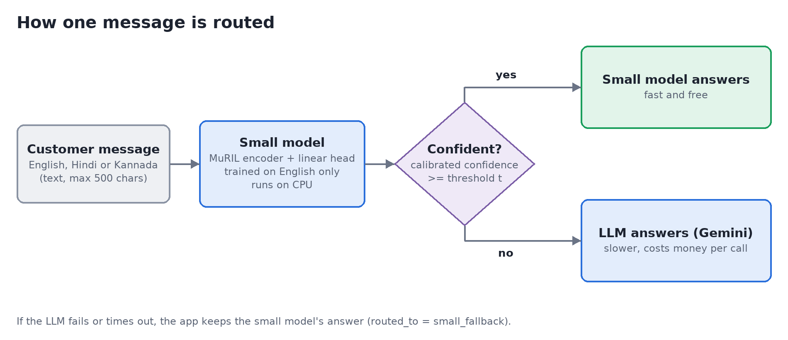
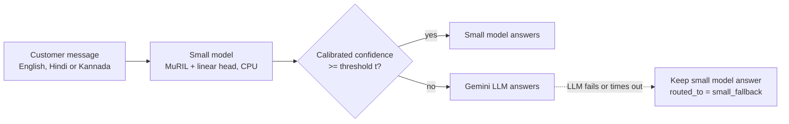
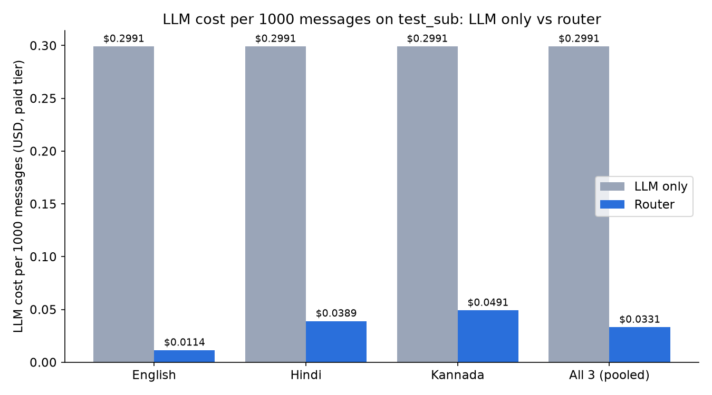
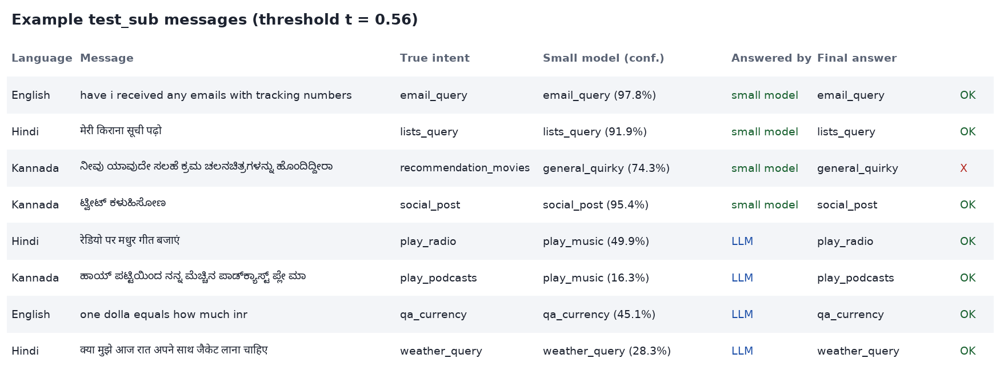
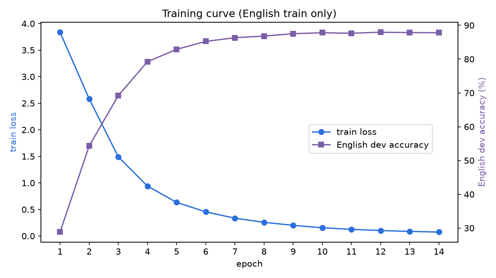

# Hybrid Intent Router

**A small model trained only on English answers 89% of English, Hindi and Kannada voice-bot messages on a CPU in about 38 ms, and matches "send everything to the LLM" accuracy at 11% of the LLM cost.**

A voice bot first has to work out what the customer wants: their *intent* (for example `alarm_set`
or `weather_query`). Sending every message to a large language model (LLM) is slow and costs money
on every call. This project fine-tunes a small multilingual model in plain PyTorch, trained on
**English only**, and tests it on **Hindi and Kannada** without any Hindi or Kannada training data
(this is called *zero-shot cross-lingual transfer*). When the small model is confident, it answers.
When it is not, the message goes to Google's Gemini LLM. The project measures how many messages the
small model handles alone, how accuracy compares with "send everything to the LLM", and how much time
and money the router saves. It is served with Flask + gunicorn behind NGINX on Linux and load-tested.

Every number below is generated from files in `results/` by `scripts/render_tables.py`, and
`make verify` fails if the tables and the files ever disagree.

## The problem

- An LLM call is a network round trip to a large model, and it is billed per token. A voice bot gets
  many short, simple messages ("set an alarm for 6 am").
- A small model is fast and free to run, but it makes more mistakes, especially in languages it
  was never trained on.
- So: let the small model answer when it is sure, and pay for the LLM only on the hard cases.
  The key question is *where to draw the line* (the confidence threshold).

## How it works





1. **Data**: Amazon MASSIVE 1.1, 60 intents, the same sentences translated into English (en-US),
   Hindi (hi-IN) and Kannada (kn-IN). Two fixed subsets with the same sentence ids in all three
   languages: `dev_sub` (300 dev sentences, used for every decision) and `test_sub` (500 test sentences,
   used only for final numbers).
2. **Small model**: `google/muril-base-cased` (a BERT-style encoder pre-trained on 17 Indian
   languages + English) with our own `nn.Linear(768, 60)` head on the first token. Trained with our
   own PyTorch loop on English train only.
3. **LLM baseline**: `gemini-3.5-flash-lite` through the official `google-genai` SDK, with JSON output
   restricted to the 60 labels. Every answer is cached in `results/llm_cache.jsonl`, so the analysis
   can be re-run without an API key.
4. **Calibration**: *temperature scaling* divides the model's raw scores (logits) by one number T
   before the softmax, so that "90% confident" really means right about 90% of the time. T is fitted
   on English dev.
5. **Routing**: confidence >= t → small model; otherwise → LLM. t is chosen on `dev_sub` with a fixed
   rule: the fewest LLM calls while staying within 1 percentage point of LLM-only accuracy.
6. **Serving**: Flask app, gunicorn (3 worker processes) behind NGINX, all on `127.0.0.1`, no sudo.


## Results

**What the numbers say** (test_sub, 500 sentences per language, threshold fixed on dev data first):

- **Same accuracy as the LLM, far cheaper and faster.** Pooled over the three languages the router scores 84.2%
  against 84.1% for the LLM alone, while sending only 11.1% of messages to the LLM. That avoids 88.9% of LLM calls,
  cuts the LLM cost per 1,000 messages from $0.2991 to $0.0331, and the typical (median-based) time per message from 1,344 ms
  to 186 ms.
- **English: the router beats both models.** The small model alone (88.2%) is already better than the LLM (86.2%)
  on English, and the router reaches 90.6% by sending only its 3.8% least confident messages to the LLM.
- **Hindi and Kannada: about 2 points below the LLM.** With zero Hindi or Kannada training data the small model
  gets 77.9% and 70.7% on the full test sets. The router sends 13.0% (Hindi) and 16.4% (Kannada) to the LLM and
  ends at 82.0% and 80.0%, against 84.2% and 81.8% for the LLM alone. The single, pooled threshold accepts this
  because English makes up the difference; a per-language threshold would buy that accuracy back with more LLM calls.
- **There is more to gain.** The oracle (right if either model is right) is 91.5%, and the test curve peaks
  near 86% when about 34-43% of messages go to the LLM: the two models make different mistakes.
- **It holds up under load.** 20 simulated users through NGINX: 41.2 requests per second, 0 failures out of
  4,908, p95 260 ms, on one laptop CPU (small model only).

### Router vs LLM only vs small model only (test_sub)

<!-- RESULTS:routing:START -->
| Language | Small only | LLM only | Router | Oracle | Sent to LLM | Router cost /1000 | LLM-only cost /1000 | Router latency* | LLM-only latency* |
|---|---|---|---|---|---|---|---|---|---|
| English | 88.2% | 86.2% | **90.6%** | 93.4% | 3.8% | $0.0114 | $0.2991 | 89 ms | 1344 ms |
| Hindi | 77.0% | 84.2% | **82.0%** | 90.8% | 13.0% | $0.0389 | $0.2991 | 212 ms | 1344 ms |
| Kannada | 70.6% | 81.8% | **80.0%** | 90.2% | 16.4% | $0.0491 | $0.2991 | 258 ms | 1344 ms |
| All 3 (pooled) | 78.6% | 84.1% | **84.2%** | 91.5% | 11.1% | $0.0331 | $0.2991 | 186 ms | 1344 ms |

test_sub, 500 messages per language. Threshold t = 0.56 was chosen on dev_sub (pooled dev accuracy 83.2%, target 83.2%, 14.3% sent to LLM). Temperature T = 1.342.

*Typical time per message, built from **median** times: small model (CPU, every message) + share sent to the LLM x median LLM single-call time. The LLM's *mean* single-call time was 3133 ms (slow outliers while the API was overloaded), so mean-based savings would be even larger.
<!-- RESULTS:routing:END -->

<!-- RESULTS:savings:START -->
| What (test_sub, all 3 languages) | Value |
|---|---|
| LLM calls avoided | 88.9% |
| LLM cost saved | 88.9% |
| Typical (median-based) latency saved per message | 1158 ms |
| Accuracy change vs LLM only | +0.1 percentage points |
<!-- RESULTS:savings:END -->






### Small model on its own

<!-- RESULTS:small:START -->
| Language | Full test (2974) | test_sub (500) | dev_sub (300) |
|---|---|---|---|
| English | 88.1% | 88.2% | 85.7% |
| Hindi | 77.9% | 77.0% | 75.7% |
| Kannada | 70.7% | 70.6% | 69.3% |

Model: `google/muril-base-cased` + linear head, trained on English only (best epoch 12). 237.6M parameters, 950.5 MB on disk. CPU latency for one message (4 threads): median 37.53 ms, p95 48.36 ms.
<!-- RESULTS:small:END -->



How it compares with published zero-shot results:

<!-- RESULTS:reference:START -->
| Zero-shot from English, full test set | Hindi | Kannada |
|---|---|---|
| XLM-R base (MASSIVE paper, App. D Table 8) | 74.8% | 63.5% |
| XLM-R (IndicXTREME, Table 19) | 74.9% | 61.7% |
| MuRIL (IndicXTREME, Table 19) | 82.4% | 77.5% |
| **This project: google/muril-base-cased** (English dev for model selection) | **77.9%** | **70.7%** |

Published numbers are copied from the papers (see `results/references.json`); they used different checkpoint selection, so compare with care.
<!-- RESULTS:reference:END -->

### LLM baseline (send everything to the LLM)

<!-- RESULTS:llm:START -->
| Language | dev_sub (300) | test_sub (500) |
|---|---|---|
| English | 84.3% | 86.2% |
| Hindi | 83.7% | 84.2% |
| Kannada | 84.7% | 81.8% |
| All 3 (pooled) | 84.2% | 84.1% |

Model `gemini-3.5-flash-lite`, prompt `v2_labels_examples`, 20 messages per request. Single-message calls (50 dev_sub items): median latency 1344 ms, p95 9114 ms, on average 890 input and 12.8 output tokens per call. Accuracy single vs batched on the same items: 82.0% vs 82.0%.
<!-- RESULTS:llm:END -->

### Calibration

<!-- RESULTS:calibration:START -->
| Data | ECE before (T = 1) | ECE after (T = 1.342) |
|---|---|---|
| English dev (full) | 0.076 | 0.016 |
| English dev_sub | 0.100 | 0.039 |
| Hindi dev_sub | 0.140 | 0.068 |
| Kannada dev_sub | 0.170 | 0.091 |

ECE = expected calibration error (lower is better), 15 bins.
<!-- RESULTS:calibration:END -->


### Load test (small model only, through NGINX)

<!-- RESULTS:loadtest:START -->
| Metric | Value |
|---|---|
| Setup | 20 users, spawn 5/s, 2m, through NGINX, small model only |
| Workers | 3 gunicorn workers x 4 torch threads |
| Requests | 4908 |
| Failures | 0 |
| Requests per second | 41.2 |
| p50 latency | 180 ms |
| p95 latency | 260 ms |
| p99 latency | 300 ms |
<!-- RESULTS:loadtest:END -->

## How to run

Needs WSL2 Ubuntu (or any Linux), Python 3.10-3.12, `nginx`, `ffmpeg`, `make`:

```bash
sudo apt install -y python3-venv python3-dev build-essential git make curl nginx ffmpeg fontconfig fonts-dejavu-core
git clone <this repo> hybrid-intent-router && cd hybrid-intent-router
python3 -m venv .venv
# PyTorch first: CUDA 12.8 build if you have an NVIDIA GPU, otherwise the CPU build
.venv/bin/pip install --timeout 120 --retries 10 torch==2.11.0 --index-url https://download.pytorch.org/whl/cpu
.venv/bin/pip install --timeout 120 --retries 10 -r requirements.txt -r requirements-dev.txt
```

(`--timeout` and `--retries` help on slow connections: the PyTorch download timed out more than once while this
project was built.)

| Step | Command | Needs |
|---|---|---|
| Download + prepare data | `make data` | internet |
| Tests, lint, number check | `make verify` | after `make data` |
| LLM baseline (cached answers are in the repo) | `make llm-pilot`, `make llm`, `make llm-single` | `GEMINI_API_KEY` in `.env` |
| Train the small model | `make smoke`, then `make train` | GPU: ~1 min per epoch on an RTX 3050 |
| Evaluate | `make evaluate` | trained model |
| Calibration + routing + charts | `make route` | evaluate + cached LLM answers |
| Update result tables in the docs | `make tables` | results |
| Serve (gunicorn + NGINX on :8080) | `make stack-up`, then `make stack-down` | trained model |
| Load test | `ROUTER_DISABLE_LLM=1 make stack-up`, `make loadtest`, `make stack-down` | running stack |
| Tutorial video | `make video`, `make video-check` | results |

The API:

```bash
curl -s http://127.0.0.1:8080/health
# {"status":"ok"}
curl -s -X POST http://127.0.0.1:8080/predict -H 'Content-Type: application/json' \
     -d '{"text": "wake me up at five am this week"}'
# {"intent": "...", "confidence": ..., "routed_to": "small" | "llm" | "small_fallback", "latency_ms": ...}
```

Open `http://127.0.0.1:8080/` for a small demo page with English, Hindi and Kannada examples.

## Design decisions

| Decision | Why |
|---|---|
| Used **MuRIL-base** because it does Hindi and Kannada zero-shot better than XLM-R base (the more popular option) | Published zero-shot MASSIVE accuracy: MuRIL 82.4 / 77.5 vs XLM-R 74.9 / 61.7 (hi / kn, IndicXTREME). Same size class, Apache-2.0 |
| Used **our own PyTorch loop** because it shows each step (forward, loss, backward, clip, step) better than the Hugging Face `Trainer` (the more popular option) | Easier to explain and debug; the whole loop is in `src/router/train.py` |
| Used **temperature scaling** because it fixes over-confidence with one number better than leaving raw softmax scores (the more common shortcut) | A threshold only makes sense if "90% confident" means right about 90% of the time |
| Chose the threshold **on dev data only** | Choosing it on test data would make the test numbers look better than they really are |
| Used **batched LLM requests (20 per call)** for the evaluation because they fit the free tier better than one call per message | Cost and latency per message were measured separately with real single calls |
| Used **gunicorn sync workers** because they suit CPU-bound PyTorch better than async workers (popular for I/O-heavy apps) | Inference blocks the CPU anyway; 3 workers x 4 threads = 12 cores |
| Ran **NGINX as a normal user** on port 8080 because it needs no sudo, unlike the system NGINX service (the usual setup) | Project-local config: pid, logs and temp folders live inside the repo |
| Used **Piper** for the narration because it runs offline and free, better than cloud text-to-speech (the more popular option) | No account or API key needed to rebuild the video |

## Limitations

- MASSIVE is voice-assistant data (alarms, music, weather), not banking or customer support.
- Hindi and Kannada sentences are professional translations, not real code-mixed speech
  ("kal ka alarm set karo").
- The LLM numbers come from a 300 + 500 sentence subset per language (free-tier limits), so they have
  a few points of sampling noise.
- LLM cost uses the paid-tier price of `gemini-3.5-flash-lite` (checked 2026-11-22); prices change.
- Training ran on a 4 GB laptop GPU; serving and latency numbers are CPU-only, on one laptop.
- Router latency is a *typical* value built from **median** times (small model + share x median LLM call). The
  LLM's mean single-call time (3,133 ms) is much higher because of slow calls during API overload.
- The load test ran with the LLM off. With the LLM on, an unsure message holds a gunicorn sync worker for the
  whole LLM call (up to about 20 s with retries), so throughput would be lower. Threaded or async workers
  (`gthread`), or a separate LLM queue, would fix that.
- The model is picked with **English** dev accuracy only. Picking with Hindi/Kannada dev data would
  probably help those languages, but it would no longer be zero-shot.

## Project layout

```
src/router/   data.py model.py train.py evaluate.py llm.py llm_baseline.py calibrate.py route.py costs.py analysis.py
app/          app.py (Flask API) templates/index.html (demo page)
deploy/       gunicorn.conf.py nginx/nginx.conf locustfile.py
scripts/      render_tables.py check_numbers.py loadtest_summary.py make_diagram.py
tests/        unit tests (data, LLM client with a fake API, model, routing, API)
results/      every number and chart in this README
docs/         journal/ (one file per phase), INTERVIEW_GUIDE.md, research/
video/        script.md build_video.py check_video.py (tutorial.mp4 is built locally)
```

## Dataset credit and license

Amazon MASSIVE 1.1 (FitzGerald et al., 2022), licensed CC BY 4.0:
https://github.com/alexa/massive. Fonts: Noto Sans Devanagari / Kannada (SIL Open Font License),
DejaVu. Model weights: `google/muril-base-cased` (Apache-2.0).

## References

- FitzGerald et al., 2022. *MASSIVE: A 1M-Example Multilingual Natural Language Understanding Dataset
  with 51 Typologically-Diverse Languages.* https://arxiv.org/abs/2204.08582
- Khanuja et al., 2021. *MuRIL: Multilingual Representations for Indian Languages.* https://arxiv.org/abs/2103.10730
- Doddapaneni et al., 2023. *Towards Leaving No Indic Language Behind (IndicXTREME).* https://arxiv.org/abs/2212.05409
- Guo et al., 2017. *On Calibration of Modern Neural Networks.* https://arxiv.org/abs/1706.04599
- Ong et al., 2024. *RouteLLM: Learning to Route LLMs with Preference Data.* https://arxiv.org/abs/2406.18665
- Ding et al., 2024. *Hybrid LLM: Cost-Efficient and Quality-Aware Query Routing.* https://arxiv.org/abs/2404.14618
