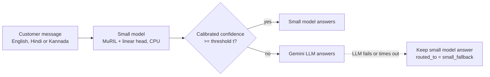
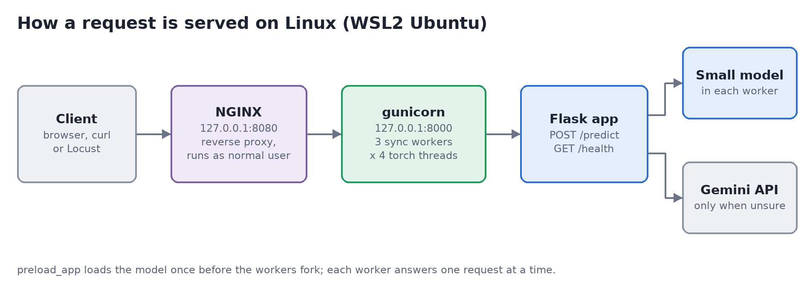
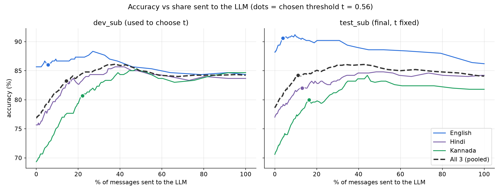
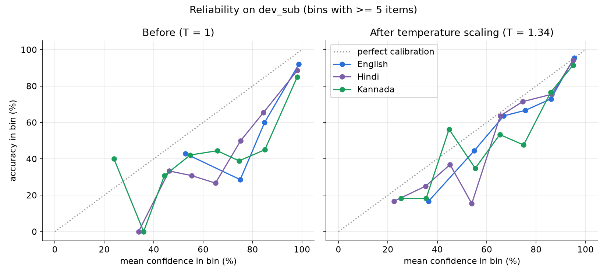

# Hybrid Intent Router

A small model trained only on English answers 89% of English, Hindi and Kannada voice-bot messages on a CPU in about 38 ms, and keeps "send everything to the LLM" accuracy at 11% of the LLM cost.

Live demo: https://hybrid-intent-router.onrender.com (free server, so the first request after a quiet spell
takes a few seconds while it wakes up). The API is at `/predict`, as described below.

Before a voice bot can do anything, it has to work out what the customer wants: their *intent*, such as
`alarm_set` or `weather_query`. You could send every message to a large language model (LLM), but each call
is a network round trip and costs money. So I fine-tuned a small multilingual model in plain PyTorch on
English data only, and tested it on Hindi and Kannada, which it never saw in training. (Training in one
language and testing in another is called zero-shot cross-lingual transfer.) When the small model is
confident, it answers. When it isn't, the message goes to Google's Gemini. I measured how many messages the
small model can take on its own, how accuracy compares with sending everything to the LLM, and how much time
and money that saves. The app runs as Flask inside gunicorn behind NGINX on Linux, and I load-tested it.

Every number in this README is generated from the files in `results/` by `scripts/render_tables.py`.
`make verify` fails if a table and its file disagree.

## The problem

An LLM call goes over the network to a big model and is billed per token, yet most voice-bot messages are
short and simple ("set an alarm for 6 am"). A small model is fast and free to run, but it makes more mistakes,
especially in languages it was never trained on. The plan is to let the small model answer when it is sure
and pay for the LLM only on the hard cases. The interesting part is deciding where to draw that line, which
is the confidence threshold.

## How it works




The data is Amazon MASSIVE 1.1: 60 intents, with the same sentences translated into English (en-US), Hindi
(hi-IN) and Kannada (kn-IN). I use two fixed subsets that share sentence ids across the three languages.
`dev_sub` (300 dev sentences) is for every decision, and `test_sub` (500 test sentences) is only for the
final numbers.

The small model is `google/muril-base-cased`, a BERT-style encoder pre-trained on 17 Indian languages and
English, with my own `nn.Linear(768, 60)` head on the first token. I trained it with my own PyTorch loop on
the English training set only.

For the LLM baseline I call `gemini-3.5-flash-lite` through the official `google-genai` SDK and force the
reply into JSON that can only hold one of the 60 labels. Every answer is cached in `results/llm_cache.jsonl`,
so the analysis re-runs without an API key.

A fine-tuned model's softmax scores tend to be over-confident, so I use temperature scaling. It divides the
raw scores (logits) by one number T before the softmax, so that "90% confident" means right about 90% of the
time. T is fitted on English dev data.

The router itself is one comparison. If the calibrated confidence is at least t, the small model's answer is
used; otherwise the LLM's. I picked t on `dev_sub` with a rule I wrote down before seeing any results: the
fewest LLM calls that keep accuracy within 1 percentage point of LLM-only.

The app is Flask, run by gunicorn with 3 worker processes behind NGINX, all on `127.0.0.1` and without sudo.



## Results

The threshold was fixed on dev data first. These are the results on `test_sub` (500 sentences per language).

Across the three languages the router scored 84.2%, against 84.1% for the LLM alone, while sending only 11.1%
of messages to the LLM. That is 88.9% fewer LLM calls. The LLM cost per 1,000 messages falls from $0.2991 to
$0.0331, and the typical (median-based) time per message from 1,344 ms to 186 ms.

In English the router beats both models. The small model alone (88.2%) is already better than the LLM
(86.2%), and the router reaches 90.6% by passing only its 3.8% least confident messages to the LLM.

Hindi and Kannada land about 2 points below the LLM. With no Hindi or Kannada training data, the small model
gets 77.9% and 70.7% on the full test sets. The router sends 13.0% of Hindi and 16.4% of Kannada messages to
the LLM and ends at 82.0% and 80.0%, while the LLM alone gets 84.2% and 81.8%. One shared threshold allows
this because English makes up the difference. A threshold per language would win that accuracy back at the
price of more LLM calls.

There is still room to improve. The oracle, which counts a message as right if either model gets it right,
reaches 91.5%, and the test curve peaks near 86% when 34-43% of messages go to the LLM. The two models make
different mistakes.

Under load, with 20 simulated users going through NGINX and the LLM switched off, the server handled 41.2
requests per second with 0 failures out of 4,908 and a p95 of 260 ms, on one laptop CPU.

### Router vs LLM only vs small model only (test_sub)

<!-- RESULTS:routing:START -->
| Language | Small only | LLM only | Router | Oracle | Sent to LLM | Router cost /1000 | LLM-only cost /1000 | Router latency* | LLM-only latency* |
|---|---|---|---|---|---|---|---|---|---|
| English | 88.2% | 86.2% | **90.6%** | 93.4% | 3.8% | $0.0114 | $0.2991 | 89 ms | 1344 ms |
| Hindi | 77.0% | 84.2% | **82.0%** | 90.8% | 13.0% | $0.0389 | $0.2991 | 212 ms | 1344 ms |
| Kannada | 70.6% | 81.8% | **80.0%** | 90.2% | 16.4% | $0.0491 | $0.2991 | 258 ms | 1344 ms |
| All 3 (pooled) | 78.6% | 84.1% | **84.2%** | 91.5% | 11.1% | $0.0331 | $0.2991 | 186 ms | 1344 ms |

test_sub, 500 messages per language. Threshold t = 0.56 was chosen on dev_sub (pooled dev accuracy 83.2%, target 83.2%, 14.3% sent to LLM). Temperature T = 1.342.

\* Typical time per message, built from median times: the small model (CPU, every message) plus the share sent to the LLM times the median LLM single-call time. The mean LLM call took 3133 ms because some calls were slow while the API was overloaded, so savings based on the mean would be even larger.
<!-- RESULTS:routing:END -->

<!-- RESULTS:savings:START -->
| What (test_sub, all 3 languages) | Value |
|---|---|
| LLM calls avoided | 88.9% |
| LLM cost saved | 88.9% |
| Typical (median-based) latency saved per message | 1158 ms |
| Accuracy change vs LLM only | +0.1 percentage points |
<!-- RESULTS:savings:END -->




### Small model on its own

<!-- RESULTS:small:START -->
| Language | Full test (2974) | test_sub (500) | dev_sub (300) |
|---|---|---|---|
| English | 88.1% | 88.2% | 85.7% |
| Hindi | 77.9% | 77.0% | 75.7% |
| Kannada | 70.7% | 70.6% | 69.3% |

Model: `google/muril-base-cased` + linear head, trained on English only (best epoch 12). 237.6M parameters, 950.5 MB on disk. CPU latency for one message (4 threads): median 37.53 ms, p95 48.36 ms.
<!-- RESULTS:small:END -->


How it compares with published zero-shot results:

<!-- RESULTS:reference:START -->
| Zero-shot from English, full test set | Hindi | Kannada |
|---|---|---|
| XLM-R base (MASSIVE paper, App. D Table 8) | 74.8% | 63.5% |
| XLM-R (IndicXTREME, Table 19) | 74.9% | 61.7% |
| MuRIL (IndicXTREME, Table 19) | 82.4% | 77.5% |
| **This project: google/muril-base-cased** (English dev for model selection) | **77.9%** | **70.7%** |

Published numbers are copied from the papers (see `results/references.json`); they used different checkpoint selection, so compare with care.
<!-- RESULTS:reference:END -->

### LLM baseline (send everything to the LLM)

<!-- RESULTS:llm:START -->
| Language | dev_sub (300) | test_sub (500) |
|---|---|---|
| English | 84.3% | 86.2% |
| Hindi | 83.7% | 84.2% |
| Kannada | 84.7% | 81.8% |
| All 3 (pooled) | 84.2% | 84.1% |

Model `gemini-3.5-flash-lite`, prompt `v2_labels_examples`, 20 messages per request. Single-message calls (50 dev_sub items): median latency 1344 ms, p95 9114 ms, on average 890 input and 12.8 output tokens per call. Accuracy single vs batched on the same items: 82.0% vs 82.0%.
<!-- RESULTS:llm:END -->

### Calibration

<!-- RESULTS:calibration:START -->
| Data | ECE before (T = 1) | ECE after (T = 1.342) |
|---|---|---|
| English dev (full) | 0.076 | 0.016 |
| English dev_sub | 0.100 | 0.039 |
| Hindi dev_sub | 0.140 | 0.068 |
| Kannada dev_sub | 0.170 | 0.091 |

ECE = expected calibration error (lower is better), 15 bins.
<!-- RESULTS:calibration:END -->



### Load test (small model only, through NGINX)

<!-- RESULTS:loadtest:START -->
| Metric | Value |
|---|---|
| Setup | 20 users, spawn 5/s, 2m, through NGINX, small model only |
| Workers | 3 gunicorn workers x 4 torch threads |
| Requests | 4908 |
| Failures | 0 |
| Requests per second | 41.2 |
| p50 latency | 180 ms |
| p95 latency | 260 ms |
| p99 latency | 300 ms |
<!-- RESULTS:loadtest:END -->

## Live demo and how it fits on a free server

The demo runs on Render's free plan, which gives 512 MB of RAM. The full-size model needs about 1.5 GB of memory to load,
so I made a smaller copy of it with `scripts/quantize.py` (`make quantize`):

- MuRIL's vocabulary covers 17 scripts, but this app only handles English, Hindi and Kannada. I kept only the
  Latin, Devanagari and Kannada tokens. WordPiece can only match vocabulary pieces that appear in the word
  itself, so text in these three languages gets exactly the same tokens.
- The word-embedding table is stored as 8-bit integers with one scale per row.
- Every Linear layer's weights are stored in 8 bits (ONNX `MatMulNBits`), and the model runs on onnxruntime,
  without PyTorch.

My first tries with standard dynamic INT8 quantization also quantized the activations, and they agreed with the
original model on only 18-82% of sentences, so I dropped them. The version below is the one that is deployed:

<!-- RESULTS:deploy:START -->
| Language | Original model (full test) | Deployed model (full test) | Same answer as original (test_sub) |
|---|---|---|---|
| English | 88.1% | 88.2% | 99.8% |
| Hindi | 77.9% | 77.7% | 99.6% |
| Kannada | 70.7% | 70.7% | 98.2% |

The deployed model is 167.6 MB instead of 950.5 MB and needs 313 MB of memory to load and answer, taking 26 ms per message on one CPU thread. With it, the router scores 83.8% on test_sub and sends 10.8% of messages to the LLM. The vocabulary keeps 90,022 of 197,258 tokens, and all 49,563 MASSIVE English, Hindi and Kannada sentences get identical tokens (49,563 of 49,563).
<!-- RESULTS:deploy:END -->

The model file lives in a public Hugging Face model repo
(https://huggingface.co/Anubhav1604/hybrid-intent-router-onnx). Render downloads it during the build and checks
each file's SHA-256 against `deploy/render/model_files.json`. `render.yaml` describes the whole service:
gunicorn with 1 worker and 4 threads behind Render's own load balancer, the `GEMINI_API_KEY` secret, and at most
10 Gemini calls per minute (`ROUTER_LLM_MAX_PER_MIN`), so strangers can't use up the API quota. Over that limit,
unsure messages get the small model's answer (`small_fallback`).

## How to run

You need WSL2 Ubuntu (or any Linux), Python 3.10-3.12, `nginx`, `ffmpeg` and `make`:

```bash
sudo apt install -y python3-venv python3-dev build-essential git make curl nginx ffmpeg fontconfig fonts-dejavu-core
git clone https://github.com/Anubhavkumarkanth/hybrid-intent-router.git && cd hybrid-intent-router
python3 -m venv .venv
# PyTorch first: CUDA 12.8 build if you have an NVIDIA GPU, otherwise the CPU build
.venv/bin/pip install --timeout 120 --retries 10 torch==2.11.0 --index-url https://download.pytorch.org/whl/cpu
.venv/bin/pip install --timeout 120 --retries 10 -r requirements.txt -r requirements-dev.txt
```

The `--timeout` and `--retries` flags are there because the PyTorch download kept timing out on my connection.

| Step | Command | Needs |
|---|---|---|
| Download + prepare data | `make data` | internet |
| Tests, lint, number check | `make verify` | after `make data` |
| LLM baseline (cached answers are in the repo) | `make llm-pilot`, `make llm`, `make llm-single` | `GEMINI_API_KEY` in `.env` |
| Train the small model | `make smoke`, then `make train` | GPU: ~1 min per epoch on an RTX 3050 |
| Evaluate | `make evaluate` | trained model |
| Calibration + routing + charts | `make route` | evaluate + cached LLM answers |
| Update result tables in the docs | `make tables` | results |
| Serve (gunicorn + NGINX on :8080) | `make stack-up`, then `make stack-down` | trained model |
| Load test | `ROUTER_DISABLE_LLM=1 make stack-up`, `make loadtest`, `make stack-down` | running stack |
| Tutorial video | `make video`, `make video-check` | results |
| Small ONNX model for the free server | `make quantize` | trained model |
| Run the app on the ONNX model | `ROUTER_ONNX_DIR=models/onnx make stack-up` | `make quantize` |

The API:

```bash
curl -s http://127.0.0.1:8080/health
# {"status":"ok"}
curl -s -X POST http://127.0.0.1:8080/predict -H 'Content-Type: application/json' \
     -d '{"text": "wake me up at five am this week"}'
# {"intent": "...", "confidence": ..., "routed_to": "small" | "llm" | "small_fallback", "latency_ms": ...}
```

`http://127.0.0.1:8080/` has a small demo page with English, Hindi and Kannada examples.

## Design decisions

| Decision | Why |
|---|---|
| Used MuRIL-base because it does Hindi and Kannada zero-shot better than XLM-R base (the more popular option) | Published zero-shot MASSIVE accuracy: MuRIL 82.4 / 77.5 vs XLM-R 74.9 / 61.7 (hi / kn, IndicXTREME). Same size class, Apache-2.0 |
| Used my own PyTorch loop because it shows each step (forward, loss, backward, clip, step) better than the Hugging Face `Trainer` (the more popular option) | Easier to explain and debug; the whole loop is in `src/router/train.py` |
| Used temperature scaling because it fixes over-confidence with one number, which leaving raw softmax scores (the common shortcut) does not | A threshold only makes sense if "90% confident" means right about 90% of the time |
| Chose the threshold on dev data only | Choosing it on test data would make the test numbers look better than they are |
| Used batched LLM requests (20 per call) for the evaluation because they fit the free tier better than one call per message | Cost and latency per message were measured separately with real single calls |
| Used gunicorn sync workers because they suit CPU-bound PyTorch better than async workers (popular for I/O-heavy apps) | Inference keeps the CPU busy anyway; 3 workers x 4 threads = 12 cores |
| Ran NGINX as a normal user on port 8080 because it needs no sudo, unlike the system NGINX service (the usual setup) | The pid file, logs and temp folders live inside the repo |
| Used Piper for the narration because it runs offline and free, which cloud text-to-speech (the more popular option) does not | No account or API key needed to rebuild the video |

## Limitations

- MASSIVE is voice-assistant data (alarms, music, weather), not banking or customer support.
- The Hindi and Kannada sentences are professional translations, not real code-mixed speech
  ("kal ka alarm set karo").
- The LLM numbers come from a 300 + 500 sentence subset per language because of free-tier limits, so they
  carry a few points of sampling noise.
- LLM cost uses the paid-tier price of `gemini-3.5-flash-lite` (checked 2026-11-22). Prices change.
- Training ran on a 4 GB laptop GPU. Serving and latency numbers are CPU-only, on one laptop.
- The live demo uses the smaller ONNX model, not the PyTorch one. It answers the same as the original on
  98-100% of the test sentences, but its exact numbers are the ones in the deployment table, not the main tables.
  Text in other scripts (for example Tamil or Bengali) becomes unknown tokens there, because the vocabulary was cut
  to English, Hindi and Kannada.
- Router latency is a typical value built from median times (small model plus the share sent to the LLM
  times the median LLM call). The mean LLM call took 3,133 ms because some calls were slow while the API was
  overloaded.
- The load test ran with the LLM off. With the LLM on, an unsure message holds a gunicorn sync worker for the
  whole LLM call (up to about 20 s with retries), so throughput would be lower. Threaded workers (`gthread`)
  or a separate LLM queue would fix that.
- The model is picked with English dev accuracy only. Picking it with Hindi or Kannada dev data would
  probably help those languages, but it would no longer be zero-shot.

## Project layout

```
src/router/   data.py model.py train.py evaluate.py llm.py llm_baseline.py calibrate.py route.py costs.py analysis.py
app/          app.py (Flask API) templates/index.html (demo page)
deploy/       gunicorn.conf.py nginx/nginx.conf locustfile.py render/ (free Render server) space/ (Hugging Face)
render.yaml   the Render service (live demo)
scripts/      render_tables.py check_numbers.py loadtest_summary.py make_diagram.py smoke_api.sh
tests/        unit tests (data, LLM client with a fake API, model, routing, API, results, video helpers)
results/      every number and chart in this README
docs/         journal/ (one file per phase), INTERVIEW_GUIDE.md, research/
video/        script.md build_video.py check_video.py (tutorial.mp4 is built locally)
```

## Dataset credit and license

Amazon MASSIVE 1.1 (FitzGerald et al., 2022), licensed CC BY 4.0:
https://github.com/alexa/massive. Fonts: Noto Sans Devanagari / Kannada (SIL Open Font License),
DejaVu. Model weights: `google/muril-base-cased` (Apache-2.0).

## References

- FitzGerald et al., 2022. *MASSIVE: A 1M-Example Multilingual Natural Language Understanding Dataset
  with 51 Typologically-Diverse Languages.* https://arxiv.org/abs/2204.08582
- Khanuja et al., 2021. *MuRIL: Multilingual Representations for Indian Languages.* https://arxiv.org/abs/2103.10730
- Doddapaneni et al., 2023. *Towards Leaving No Indic Language Behind (IndicXTREME).* https://arxiv.org/abs/2212.05409
- Guo et al., 2017. *On Calibration of Modern Neural Networks.* https://arxiv.org/abs/1706.04599
- Ong et al., 2024. *RouteLLM: Learning to Route LLMs with Preference Data.* https://arxiv.org/abs/2406.18665
- Ding et al., 2024. *Hybrid LLM: Cost-Efficient and Quality-Aware Query Routing.* https://arxiv.org/abs/2404.14618
